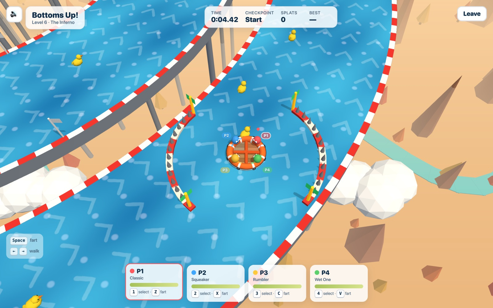
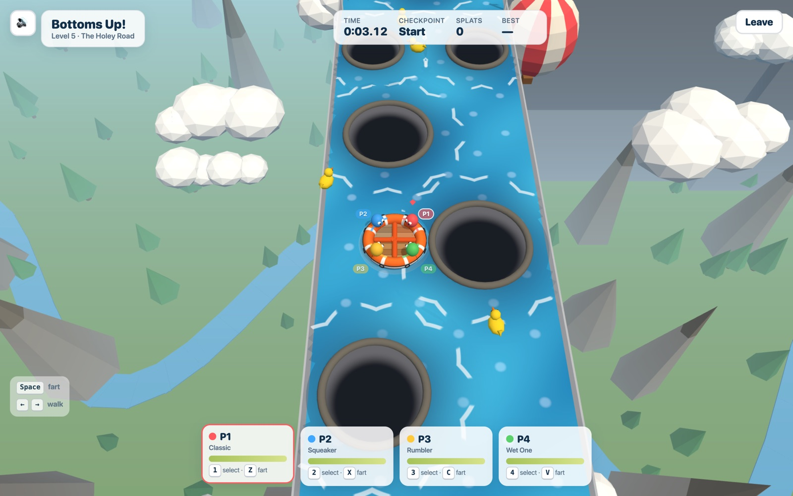
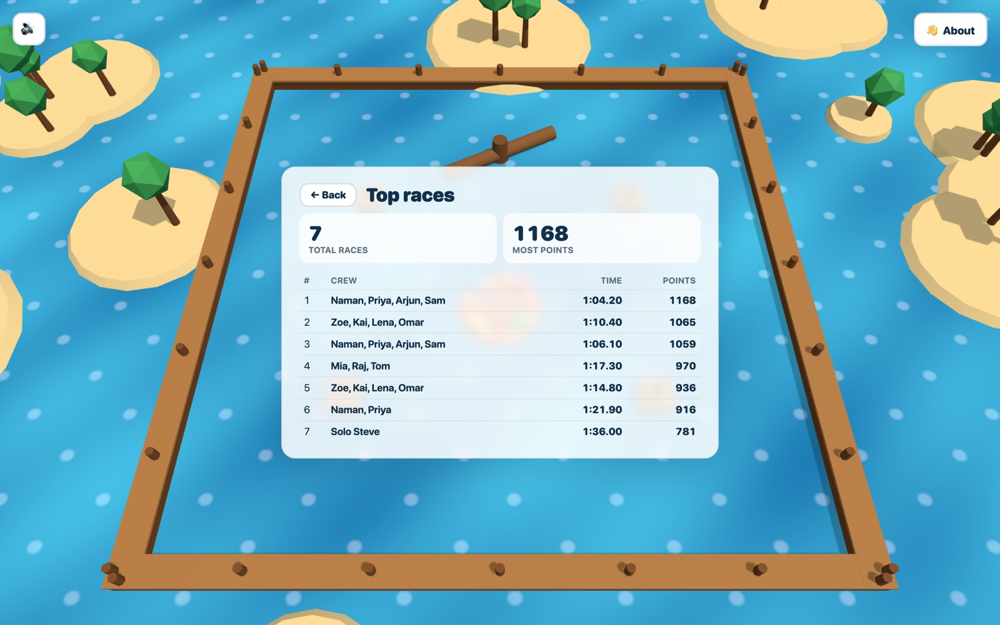
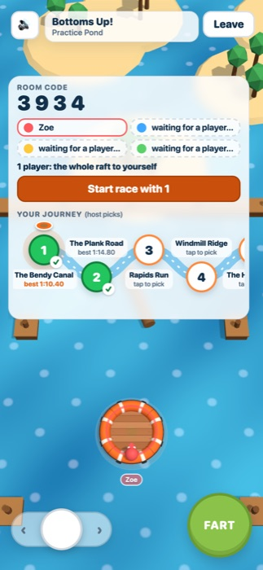
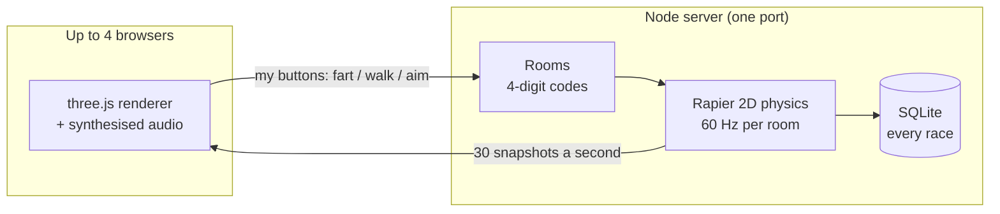

<div align="center">

# 💨 Bottoms Up!

**Up to four friends. One round raft. Only farts for power.**

A silly co-op physics racer you play together in the browser. Sit on the rim of an inflatable raft,
aim your bottom at the water, and toot your crew through canals, spikes, windmills and a giant spiral river.

### [▶ Play now: bottomsup.tech](https://bottomsup.tech)

No download, no account. Type a name and play alone, or share a 4-digit room code with friends.




</div>

## How it plays

Everyone sits on the raft's tube **facing the centre**, so a fart pushes the raft from where you sit
straight through its middle. Want to go forward? The people at the back toot. Want to turn? Walk
round the rim and push from the side, or turn away from the centre to spin it. Push against each
other and nothing happens. **The secret isn't farting harder, it's farting together.**

- 🎈 **The rim is split between whoever's playing**: alone you get all 360°, two players get half each, three get 120°, four get a quarter. The raft's thwarts mark where your bit ends.
- ⛽ **Gas runs out.** Hold too long and your card flashes red. Every fart starts with a punchy *toot*.
- 🔊 **Every player has their own fart voice**: Classic, Squeaker, Rumbler and Wet One, all synthesised in code.
- 🚦 **F1-style start lights**: red, red, orange… GO!

<table>
  <tr>
    <td width="50%"><br><b>The Holey Road.</b> Holes that drag you in if you get close. Even the rubber ducks can't escape.</td>
    <td width="50%"><br><b>Top races.</b> The total races run, and the ten highest scores.</td>
  </tr>
</table>

<p align="center"><br><b>Phones work too:</b> a joystick to walk and a big FART button.</p>

## Levels

| | Level | What's in it | Par |
|---|---|---|---|
| 1 | **The Bendy Canal** | Walled canal, a tight gap, a sharp turn onto spikes, a sideways current | 1:15 |
| 2 | **The Plank Road** | No walls. Thin roads over a drop, a crosswind and a sweeping gate | 1:10 |
| 3 | **Rapids Run** | Spiked barrier, three raging corners, a long unprotected road | 3:00 |
| 4 | **Windmill Ridge** | Spiked windmills sweeping across a track with no walls | 2:30 |
| 5 | **The Holey Road** | Holes that pull you in, narrowing lanes, then a crosswind | 2:00 |
| 6 | **The Inferno** | A 476 m spiral river, spinning spike circles, holes and windmills | 5:00 |

Every level is open from the start. In a room, the host picks the level on the journey map and
everyone sees the raft move there.

## Scoring

Only time counts; splats don't. **Points = 1000 × par ÷ your time**, so finishing in par time scores
1000 and twice as fast scores 2000. Every finished race is kept forever with the crew's names and
the date. There's a separate leaderboard for solo runs and for 2, 3 and 4-player crews, because
they aren't comparable.

## Controls

| | Keyboard | Phone | Gamepad |
|---|---|---|---|
| **Fart** | `Space`, `F` or click | FART button | `A` / `RT` |
| **Walk left / right round the rim** | `A` `D` or `←` `→` | joystick | d-pad |
| **Turn away from the centre** (adds spin) | `Q` `E` or hold right mouse | | left stick |
| **Face the centre again** | `W` | | `Y` |
| **Stuck? Back to the checkpoint** | `R` | | |
| **Mute / help** | `M` / `H` | | |

In Single player you have the whole rim to yourself: `←` walks clockwise, `→` walks
counter-clockwise, and you can keep going round in circles.

## How it works



- **The server owns the game.** Each room's physics runs on the server at 60 Hz, so all four players see exactly the same raft. Browsers only send their own buttons.
- **Smooth on a real connection.** Clients draw the world about 100 ms in the past and blend between snapshots. Your own fart sound plays the instant you press.
- **Refresh-proof.** Reload the page or lose WiFi for a moment and you're put straight back in your seat. A room disappears 30 s after the last person leaves.
- **One physics engine, two places.** The same simulation code runs on the server for online play and in the browser for solo practice.
- **No sound files.** Each fart is built from irregular "flaps" of air (pitch wobble, sputter, wetness) in [`fartsynth.js`](src/fartsynth.js).

## Run it yourself

```bash
npm install
npm run build     # build the game into dist/
npm start         # game server on http://localhost:8080
```

`npm run dev` gives a hot-reloading client on port 5173 that talks to the server above.
Hosting it for friends on a cloud VM (EC2, Oracle Cloud, any Linux box) is one script; see
[deploy/README.md](deploy/README.md).

### Tests

```bash
npm run test:sim      # physics checks + an autopilot that beats level 1
npm run test:net      # real server + 4 WebSocket clients: rooms, a full race, scores
npm run test:levels   # every level must be beatable by every crew size (a few minutes)
npm run screenshots   # retake the README pictures (headless Chrome)
npm run sounds        # render the fart voices to sound-preview/*.wav
```

### Project layout

| Path | What's there |
|---|---|
| `src/sim/` | The physics game itself (Rapier 2D, no DOM): `sim.js`, the levels, scoring |
| `server/` | HTTP + WebSocket server, rooms (lobby → countdown → race → results), SQLite scores |
| `src/` | The browser client: renderer, HUD, input (keyboard, mouse, gamepad, touch), audio |
| `scripts/` | Tests, the level-checking autopilot, the screenshot taker |
| `deploy/` | One-command server setup, systemd service, update script |

**Adding a level:** write a level file in `src/sim/` (walls, optional `water` for a drop, which can
be rectangles, round pools or curving channels, currents,
moving obstacles, checkpoints, finish, par and a `route` for the test autopilot), add it to
`LEVELS` and `RACE_LEVELS` in `levels.js`, then run `npm run test:levels` to prove every crew size
can finish it.

---

<div align="center">
Made with 💨 by <a href="https://github.com/namankhurpia">@namankhurpia</a>. An original game inspired by the co-op shared-raft idea; no code or assets from any other game.
</div>
