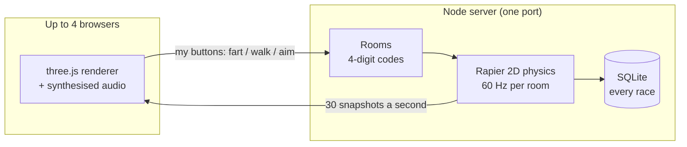

<div align="center">

# 💨 Bottoms Up!

**Up to four friends. One round raft. Only farts for power.**

A silly co-op physics racer you play together in the browser. Sit on the rim of an inflatable raft,
aim your bottom at the water, and toot your crew through canals, spikes and raging rapids.

### [▶ Play now: http://192.9.238.244](http://192.9.238.244)

No download, no account. Type a name, share a 4-digit room code, go.


</div>

## How it plays

Everyone sits on the raft's tube **facing the centre**, so a fart pushes the raft from where you sit
straight through its middle. Want to go forward? The people at the back toot. Want to turn? Walk
round the rim and push from the side, or turn away from the centre to spin it. Push against each
other and nothing happens. **The secret isn't farting harder, it's farting together.**

<p align="center"></p>

- 🎈 **The rim is split between whoever's playing**: alone you get all 360°, two players get half each, three get 120°, four get a quarter. The raft's thwarts mark where your bit ends.
- ⛽ **Gas runs out.** Hold too long and your card flashes red. Every fart starts with a punchy *toot*.
- 🔊 **Every player has their own fart voice**: Classic, Squeaker, Rumbler and Wet One, all synthesised in code.
- 🚦 **F1-style start lights**: red, red, orange… GO!

<table>
  <tr>
    <td width="50%"><br><b>The lobby.</b> Share the room code and paddle round the practice pond while your crew joins.</td>
    <td width="50%"><br><b>Lights out.</b> Red, red, orange, green. Everyone's lights change together.</td>
  </tr>
  <tr>
    <td><br><b>Level 2 · The Plank Road.</b> No walls, just thin water channels high above a valley. Drift off and you fall.</td>
    <td><br><b>Level 3 · Rapids Run.</b> The long one: raging corners that take two to fight, then a long road over the drop.</td>
  </tr>
  <tr>
    <td><br><b>The journey.</b> A map of every level; finish one with any crew to unlock the next. Your raft shows where you are.</td>
    <td><br><b>Race history.</b> Every race ever, with times, crews and dates.</td>
  </tr>
</table>

<p align="center"><br><b>Phones work too:</b> a joystick to walk and a big FART button.</p>

## Levels

| | Level | What's in it | Par |
|---|---|---|---|
| 1 | **The Bendy Canal** | Walled canal, a tight gap, a sharp turn onto spikes, a sideways current | 1:15 |
| 2 | **The Plank Road** | No walls. Thin roads over a drop, a crosswind and a sweeping gate | 1:10 |
| 3 | **Rapids Run** | Spiked barrier, three raging corners, a long unprotected road | 3:00 |

Finishing a level (with any number of players) unlocks the next one for everyone in that crew.
In a room, the host picks the next level on the journey map and everyone sees the raft move there.

## Scoring

Only time counts; splats don't. **Points = 1000 × par ÷ your time**, so finishing in par time scores
1000 and twice as fast scores 2000. Every finished race is kept forever with the crew's names and
the date. There's a separate leaderboard for solo runs and for 2, 3 and 4-player crews, because
they aren't comparable.

## Controls

| | Keyboard | Phone | Gamepad |
|---|---|---|---|
| **Fart** | `Space`, `F` or click | FART button | `A` / `RT` |
| **Walk left / right round the rim** | `A` `D` or `←` `→` | joystick | d-pad |
| **Turn away from the centre** (adds spin) | `Q` `E` or hold right mouse | | left stick |
| **Face the centre again** | `W` | | `Y` |
| **Stuck? Back to the checkpoint** | `R` | | |
| **Mute / help** | `M` / `H` | | |

Solo practice lets one person drive all four: `1`–`4` pick a player, `Z` `X` `C` `V` fart for each,
and holding `Shift` moves everyone at once.

## How it works



- **The server owns the game.** Each room's physics runs on the server at 60 Hz, so all four players see exactly the same raft. Browsers only send their own buttons.
- **Smooth on a real connection.** Clients draw the world about 100 ms in the past and blend between snapshots. Your own fart sound plays the instant you press.
- **Refresh-proof.** Reload the page or lose WiFi for a moment and you're put straight back in your seat. A room disappears 30 s after the last person leaves.
- **One physics engine, two places.** The same simulation code runs on the server for online play and in the browser for solo practice.
- **No sound files.** Each fart is built from irregular "flaps" of air (pitch wobble, sputter, wetness) in [`fartsynth.js`](src/fartsynth.js).

## Run it yourself

```bash
npm install
npm run build     # build the game into dist/
npm start         # game server on http://localhost:8080
```

`npm run dev` gives a hot-reloading client on port 5173 that talks to the server above.
Hosting it for friends on a cloud VM (EC2, Oracle Cloud, any Linux box) is one script; see
[deploy/README.md](deploy/README.md).

### Tests

```bash
npm run test:sim      # physics checks + an autopilot that beats level 1
npm run test:net      # real server + 4 WebSocket clients: rooms, unlocks, a full race, scores
npm run test:levels   # every level must be beatable by every crew size (a few minutes)
npm run screenshots   # retake the README screenshots (headless Chrome)
npm run sounds        # render the fart voices to sound-preview/*.wav
```

### Project layout

| Path | What's there |
|---|---|
| `src/sim/` | The physics game itself (Rapier 2D, no DOM): `sim.js`, the levels, unlock rule, scoring |
| `server/` | HTTP + WebSocket server, rooms (lobby → countdown → race → results), SQLite scores |
| `src/` | The browser client: renderer, HUD, input (keyboard, mouse, gamepad, touch), audio |
| `scripts/` | Tests, the level-checking autopilot, the screenshot taker |
| `deploy/` | One-command server setup, systemd service, update script |

**Adding a level:** write a level file in `src/sim/` (walls, optional `water` for a drop, currents,
moving obstacles, checkpoints, finish, par and a `route` for the test autopilot), add it to
`LEVELS` and `RACE_LEVELS` in `levels.js`, then run `npm run test:levels` to prove every crew size
can finish it.

---

<div align="center">
Made with 💨 by <a href="https://github.com/namankhurpia">@namankhurpia</a>. An original game inspired by the co-op shared-raft idea; no code or assets from any other game.
</div>
